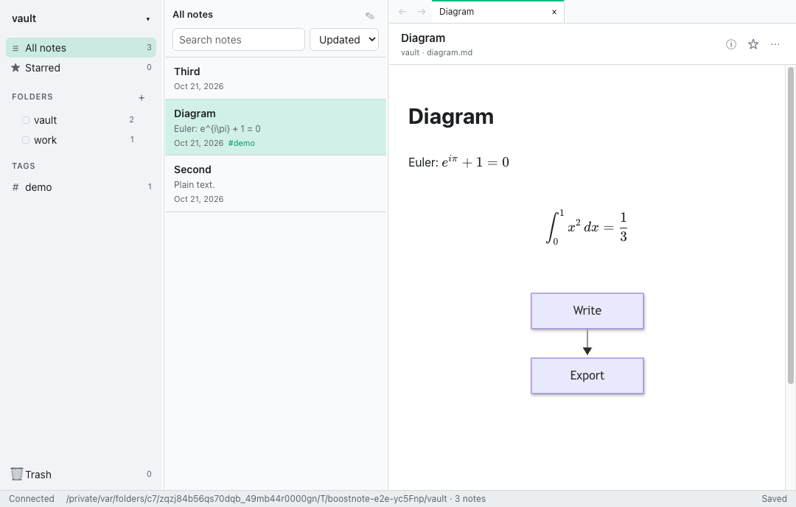

<h1 align="center">Boostnote</h1>

<p align="center">A note-taking app for programmers: plain Markdown files, a live-preview editor, math and diagrams.<br>
macOS, Windows and Linux. Built with Electron and Remix 3.</p>



This is a modernised fork of [BoostNote-Legacy](https://github.com/BoostIO/BoostNote-Legacy). The old
React/Redux app and its CSON storage are gone; notes are now ordinary `.md` files in a folder you
choose, so any editor, `git` or sync tool works with them. The background and decisions are in
[docs/modernisation/PLAN.md](docs/modernisation/PLAN.md).

## Features

- **Vaults of plain Markdown.** A vault is any folder: notes are `.md` files with optional YAML
  frontmatter (`title`, `tags`, `starred`, `created`, `updated`, and any keys of your own, kept
  verbatim), folders are directories, pasted images live next to the note in `<note>.assets/`.
- **One live-preview editor** (CodeMirror 6, Obsidian/Typora style): markers hide when the cursor
  leaves a construct, and an unfocused note looks fully rendered. Images, task checkboxes, tables,
  KaTeX math (`$…$`, `$$…$$`, ```` ```math ````) and ```` ```mermaid ```` diagrams render in place.
  Syntax-highlighted fenced code, `/` slash commands, markdown shortcuts, list continuation, image
  paste/drop, HTML paste → Markdown.
- **Live reload.** Edit a note in another app and it updates; edits on both sides end in a conflict
  bar instead of silent data loss.
- **Organise:** folder tree with colours, tags, starred notes, full-text search, sort, a Trash with
  restore, drag and drop. Renaming or moving a note or folder offers to update the links to it.
- **Tabs** with per-tab back/forward, restored per vault. A **properties panel** for frontmatter.
- **Export:** a note as standalone HTML (math, diagrams and images included, no scripts), PDF, or
  Markdown with its assets; print; a folder or the whole vault as a static HTML site.
- **Several vaults open at once.** The vault menu at the top of the sidebar lists the open vaults
  and switches between them at once, each keeping its tabs; open vaults are reopened on the next start.
- **Open `.md` files** from Finder/Explorer: the file's folder opens as a vault.
- **Drop `.md` files and folders** onto the app to copy them into the vault: onto a folder in the
  sidebar, or anywhere else for the selected folder. Images and files they link to are copied into
  the note's `.assets/` folder, links between dropped notes are kept working, and the originals are
  never moved or changed.
- **Preferences:** light/dark/system theme, editor font, size and width, spellcheck, a global
  show/hide hotkey. Every command has a native menu item and shortcut.

## Install

Download an installer from the [releases](https://github.com/adrianbrowning/BoostNote/releases)
(macOS `.dmg`/`.zip`, Windows NSIS `.exe`, Linux `.AppImage`/`.deb`). Builds are unsigned unless
signing secrets are configured, so macOS may ask you to confirm the first launch (right-click → Open).

## Updates

Boostnote never downloads or installs anything by itself. New versions are published on the
[releases](https://github.com/adrianbrowning/BoostNote/releases) page; download and install them
as above. Once a day (and 10 seconds after launch) the installed app asks
`api.github.com` — the only server it contacts for this — for the newest published release. When
it is newer than yours, the status bar shows "Boostnote X.Y.Z is available — Download"; Download
opens the release page in your browser, × hides the notice for that version (a later version
shows again). Turn the daily check off in Preferences ("Check for updates automatically");
**Check for Updates…** (app menu on macOS, Help on Windows/Linux) checks on demand.

## Coming from Boostnote (legacy)

Use **File → Import Boostnote Storage…** (or `pnpm migrate <legacyStorageDir> <targetVaultDir>`). The
importer only reads the old storage and writes a new vault: folders, tags, starred state, dates,
attachments and snippet notes (converted to Markdown with fenced code) carry over. Details and the
full mapping: [docs/modernisation/MIGRATION.md](docs/modernisation/MIGRATION.md).

## Command line and MCP

`boostnote` reads and edits a vault from a terminal, scripts or AI agents. Install it from the app
with **Install Command Line Tool…** (app menu on macOS, Help on Linux): it writes a small `boostnote`
script into `/usr/local/bin` when that is writable, else `~/.local/bin`, and tells you which and
whether it is on your PATH; the script runs the CLI on the app's own binary, so run it again if you
move the app. On Windows, **Help → Command Line Tool…** shows the command to use
(`$env:ELECTRON_RUN_AS_NODE=1; & "<Boostnote.exe>" "<app>\resources\app\src\cli\index.js" …`). From a
checkout, use `pnpm cli …` or `node src/cli/index.js …`.

The vault is `--vault <dir>`, else `$BOOSTNOTE_VAULT`, else the vault last opened in the app. Note
ids are paths relative to the vault (`work/todo.md`); a bare name (`todo`) works when only one note
has it. Add `--json` for machine-readable output. Exit codes: 0 ok, 1 error, 2 usage, 3 conflict
(the note changed), 4 not found.

```sh
boostnote search docker prune --limit 5
boostnote list --folder work --tag urgent --sort title
boostnote read todo                      # properties, hash and body (--raw: the file as stored)
boostnote create work --name "Standup" --tag meeting < agenda.md
boostnote append todo "- [ ] call the bank"
boostnote write work/todo.md --base-hash <hash from read> < todo.md   # exit 3 if it changed since
boostnote set-props todo tags=work,urgent starred=true --unset draft
boostnote rename work/todo.md "Todo list"  # links in other notes follow (--no-update-links to skip)
boostnote move work/todo.md archive        # reports how many links were updated
boostnote trash todo && boostnote restore work/todo.md   # trash is restorable; nothing is deleted
boostnote tags; boostnote folders; boostnote tasks todo
```

Writes go through the same storage code as the app (atomic, never outside the vault). With the app
open, it reloads a note the CLI changed, or shows its conflict bar if you were editing it.

**MCP:** `boostnote mcp [--vault <dir>]` is a [Model Context Protocol](https://modelcontextprotocol.io)
server on stdio with the same operations as tools (`search_notes`, `read_note`, `write_note`,
`append_to_note`, `update_properties`, `create_note`, `rename_note`, `move_note`, `trash_note`,
`restore_note`, `list_notes`, `list_tags`, `list_folders`, `task_progress`) and every note as a
resource (`boostnote://note/<id>`). Agents are told to read a note before changing it and pass its
`hash` as `baseHash`, so they never overwrite an edit made meanwhile.

Claude Desktop (`claude_desktop_config.json`) and Cursor (`.cursor/mcp.json` or `~/.cursor/mcp.json`):

```json
{
  "mcpServers": {
    "boostnote": { "command": "boostnote", "args": ["mcp", "--vault", "/path/to/vault"] }
  }
}
```

Claude Code: `claude mcp add boostnote -- boostnote mcp --vault /path/to/vault`, or the same
`mcpServers` entry in the project's `.mcp.json`. GUI clients may not see `~/.local/bin`; use the full
path of the installed `boostnote` as `command` then. From a checkout, use `"command": "node"` with
`"args": ["/path/to/BoostNote/src/cli/index.js", "mcp", "--vault", "/path/to/vault"]` (not
`pnpm cli`, which prints its own banner on stdout).

**omp memory:** [`integrations/omp`](integrations/omp/README.md) is an omp plugin that uses this MCP
server to give the agent a memory vault of its own, with global and per-project notes.

## Development

Requires Node.js 24+ and pnpm 10 (`corepack enable`).

```sh
pnpm install
pnpm dev
```

| Script | What it does |
| --- | --- |
| `pnpm dev` | Run the app from source; browser modules recompile on change (reload the window), main-process changes need a restart. |
| `pnpm check` / `pnpm fix` | Biome lint + format check / apply safe fixes. |
| `pnpm typecheck` | TypeScript (strict, `noEmit`). |
| `pnpm test` | Vitest unit tests (`tests/`, excluding `tests/e2e`). |
| `pnpm test:e2e` | Playwright smoke tests driving the real Electron app (`tests/e2e`). |
| `pnpm build` | Typecheck, then render the app with production settings and compile every browser asset. |
| `pnpm dist` | `pnpm build`, then installers in `dist/` via electron-builder (build each on its own OS). |
| `pnpm migrate <src> <dst>` | Convert a legacy Boostnote storage into a vault from the command line. |
| `pnpm cli <command>` | The `boostnote` command line from source (see [Command line and MCP](#command-line-and-mcp)). |

See [contributing.md](contributing.md) for the workflow and project layout.

## Architecture

- **Electron main process** (`src/main`) runs TypeScript directly through `remix/node-tsx`; there is
  no bundler. It owns the window, native menus, dialogs, the settings file and every disk access.
- **Remix 3 router in main** (`src/app`): the renderer loads `boost://app/`, and `protocol.handle`
  answers each request with `router.fetch()`: server-rendered pages, a JSON API, browser modules
  compiled on demand by `remix/assets`, and one Server-Sent Events stream for pushes (menu commands,
  file changes).
- **Sandboxed renderer:** `contextIsolation`, `sandbox`, no Node, a nonce-based CSP. Its one preload
  exposes a single function that turns dropped files into their paths (for drop import).
- `src/vault` — storage core (notes, frontmatter, folders, assets, trash, watcher, search index).
- `src/editor` — the CodeMirror 6 live-preview editor. `src/markdown` — the export renderer
  (markdown-it, KaTeX, server-side highlighting, sanitising; mermaid laid out in a hidden window).
- `src/migrate` — legacy CSON importer.
- `src/cli` — the `boostnote` command line and MCP server over `src/vault`.

## License

[GPL v3](./LICENSE). Copyright © 2016-2026 BoostIO, Inc. and contributors.
