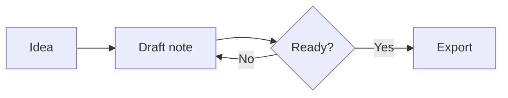

# Markdown tour

Boostnote shows your Markdown as you type. Move the cursor into a line to see its **markers**, *emphasis*, ~~strike-through~~ and `inline code`.

## Links and images

Link to another note, like [Website redesign](Work/Projects/Website%20redesign.md), or to the web, like [the Boostnote repository](https://github.com/adrianbrowning/BoostNote).


## Tasks

- [x] Write the first note
- [x] Add a table
- [ ] Draw a diagram
- [ ] Share the vault as a website

## Table

| Shortcut | What it does |
| --- | --- |
| Type `/` | Opens the block menu |
| `**text**` | Bold text |
| `- [ ]` | A task |

## Math

The area of a circle is $A = \pi r^2$, and a sum looks like this:

$$
\sum_{k=1}^{n} k = \frac{n(n+1)}{2}
$$

## Diagram



## Code

```ts
export function greet(name: string): string {
  return `Hello, ${name}!`
}
```

> A quote stays a quote, and a line of three dashes is a divider.

---
